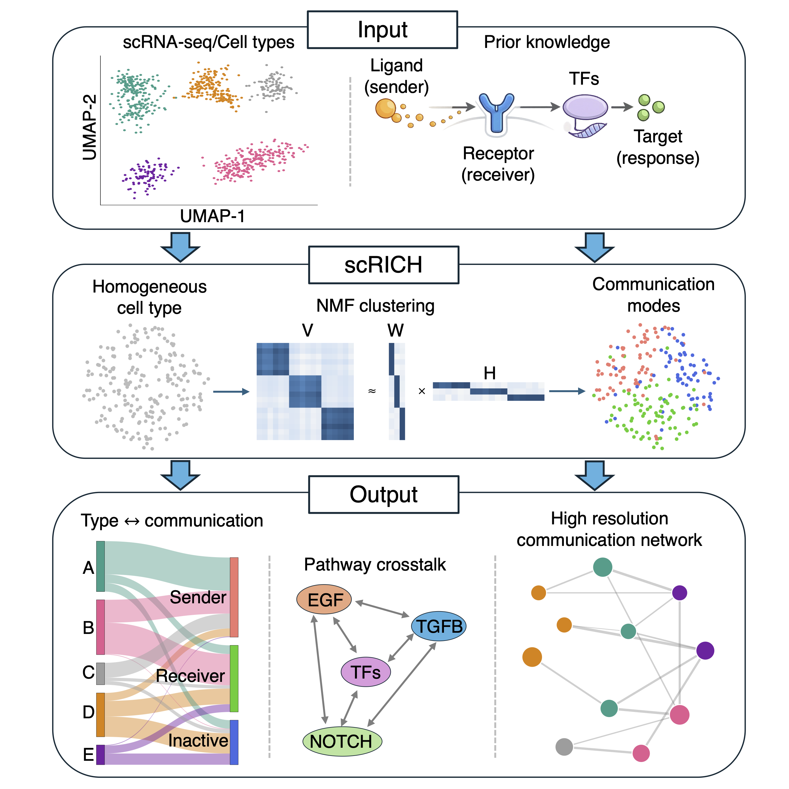

# scRICH — Robust Identification of Cell-cell Communication Heterogeneity

This repository hosts the code of the scRICH method, published in
[Cell Systems](https://www.cell.com/cell-systems/fulltext/S2405-4712(26)00185-7).
The method is developed by [Federico Bocci](https://www.ru.nl/en/departments/radboud-institute-for-molecular-life-sciences/computational-cell-fate)
at Radboud University.



> **Branch `refactor/v1` — work in progress.** This branch turns scRICH into an installable
> Python package. The analysis functions are unchanged; the version used in the paper is the
> GitHub release [`v0.1.0.0`](https://github.com/federicobocci/Robust-Identification-of-Cell-cell-Communication-Heterogeneity-in-single-cells/releases)
> (Zenodo DOI [10.5281/zenodo.20394264](https://doi.org/10.5281/zenodo.20394264)).

## Installation

scRICH requires Python ≥ 3.10 (3.12 recommended). Install into a fresh environment.

**With [uv](https://docs.astral.sh/uv/) (fast, recommended)**

```bash
git clone https://github.com/federicobocci/Robust-Identification-of-Cell-cell-Communication-Heterogeneity-in-single-cells scrich
cd scrich
uv venv --python 3.12 .venv
source .venv/bin/activate
uv pip install -e ".[tutorials]"
```

**With pip / venv**

```bash
python3.12 -m venv .venv
source .venv/bin/activate
pip install -e ".[tutorials]"
```

**With conda**: `conda env create -f environment.yml && conda activate scrich`

Optional extras: `velocity` (scvelo + seaborn, for RNA-velocity functions and plots), `alluvial` (plotly +
kaleido, for `scrich.pl.alluvial_*`), `chord` (d3blocks, for `scrich.pl.chord_diagram`), `tutorials` (all of
these + JupyterLab + LIANA), `dev` (pytest, ruff).
A plain `pip install -e .` installs only the core package.

## Databases

scRICH uses two kinds of database files (see `scrich.db`):

| Data | Size | Where it lives |
|---|---|---|
| Pathway → ligand / receptor tables (CellChatDB) | ~50 kB | Shipped inside the package |
| exFinder layers (L→R, R→TF, TF→target) + CellChat interactions, human & mouse | ~21 MB | Downloaded on first use and cached |

The external files are only needed for `scrich.tl.import_database` (target genes of a pathway).
They are downloaded automatically once the database is published on Zenodo. Until then — or
on a computer without internet — point scRICH to a local copy:

```bash
export SCRICH_DATA_DIR=/path/to/scrich_db_v1
```

or in Python:

```python
import scrich as ri
ri.db.set_data_dir("/path/to/scrich_db_v1")
ri.db.fetch_all()   # check that all files are present and valid
```

Files are verified with SHA256 checksums. `scripts/convert_exfinder_to_parquet.py` documents how
they were produced from the original exFinder data.

## Quick start

```python
import scrich as ri

ri.tl.pathways_overview(adata, species="mouse")
ri.tl.all_path_sim(adata, "celltype", pathways_to_use=10, species="mouse", neighbor_average=True)
ri.tl.permutation_testing(adata, key="celltype")
ri.pl.pathway_heterogeneity_summary(adata, key="celltype")
```

Plots are shown by default and never saved automatically. To keep a plot, return it and save it:

```python
ax = ri.pl.single_pathway_heterogeneity(adata, "IGF", "celltype", show=False)
ax.figure.savefig("IGF_heterogeneity.pdf")
```

Use `ri.settings.autoshow = False` in scripts, and `ri.set_verbosity("warning")` to reduce progress messages.

## Tutorials

The notebooks in `tutorials/` cover the main analysis (tutorial 1), modifying the ligand-receptor
set of a pathway (2), integrating LIANA (3), comparing RNA velocity methods (4) and spatial
transcriptomics (5). Datasets for tutorials 3–5 are on Zenodo, record
[19859013](https://zenodo.org/records/19859014).

## Documentation

The documentation (installation, analysis steps, databases, plotting, tutorials and the API reference
generated from the docstrings) is in `docs/` and is built with Sphinx for Read the Docs
(`.readthedocs.yaml`). To build it locally:

```bash
pip install -e ".[docs]"
sphinx-build -b html docs docs/_build/html      # then open docs/_build/html/index.html
```

## Development

```bash
uv pip install -e ".[dev]"
pytest                                   # fast tests
SCRICH_DATA_DIR=/path/to/scrich_db_v1 pytest   # also runs the database tests
```

## Contacts

For any question, get in touch with Federico Bocci.
